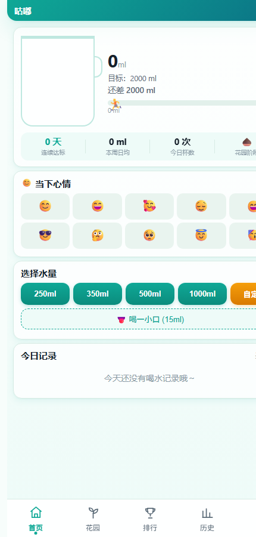

<div align="center">
  

  # 咕嘟 · Glug Water

  **把喝水这件事，做成一只会慢慢满起来的杯子。**

  纯 HTML / CSS / JavaScript 单文件 · 零依赖 · PWA · 数据保存在本机

  
  
  
  

  <a href="https://kidnappe.github.io/glug-water/">在线使用</a> · <a href="https://github.com/kidnappe/glug-water/releases">Releases</a> · <a href="CHANGELOG.md">更新日志</a> · <a href="schema.sql">数据库结构</a>
</div>


---

## 它是什么

咕嘟是一个喝水记录工具。打开网页，点一下杯子旁边的快捷水量，今天的进度就会往上涨；连续达标，花园里的植物会从种子慢慢长大。

整个应用就是一个 `index.html`：没有框架、没有构建步骤、没有后端依赖。数据默认保存在浏览器本地，想多设备同步时再自己接一个可选的 Supabase 项目。

---

## 设计语言

- 主色落在水的青和植物的绿之间，首页、花园、统计共用一条色带。
- 签名元素是水杯：杯身、水面、气泡和刻度构成进度反馈。
- 颜色只表达语义：暖橙留给大剂量和吃药提醒，绿色留给达标与花园。
- 数字使用等宽字体，记录时不会左右跳动。
- 水面、撒花、气泡和植物生长都有轻量动效，但不阻塞操作。

视觉方案与改版记录见 [`docs/redesign-plan.md`](docs/redesign-plan.md)。

---

## 功能

### 首页与记录

| 功能 | 说明 |
|---|---|
| 今日进度 | 水杯可视化今日喝水量、目标、还差多少 |
| 一键记录 | 250 ml / 350 ml / 500 ml / 1000 ml / 自定义，另有 15 ml 小口 |
| 心情打卡 | 记录当下心情，作为当天状态的一部分 |
| 今日记录 | 查看每条喝水记录，可删除单条 |
| 连续达标 | 显示连续达标天数、本周日均和今日杯数 |
| 花园养成 | 连续达标让植物从种子、嫩芽到开花逐步成长 |
| 达标庆祝 | 达标后触发撒花、水杯发光和植物弹跳 |

### 排行榜与历史

| 功能 | 说明 |
|---|---|
| 多周期排行 | 今日 / 本周 / 本月，自动累计 |
| 自定义身份 | 50 种动物头像 + 自定义昵称 |
| 连击显示 | 连续达标天数 |
| 在线排行 | 配置 Supabase 后可与亲友实时比拼（可选） |
| 周 / 月图表 | Canvas 自绘柱状图，标出目标线 |
| 统计摘要 | 日均、最高、最低、达标天数 |
| 喝水日历 | 月度热力图，点击日期查看当天记录，可翻月 |

### 设置与数据

| 功能 | 说明 |
|---|---|
| 每日目标 | 自定义，默认 2000 ml |
| 快捷水量 | 自定义快捷按钮的默认水量 |
| 喝水提醒 | 浏览器通知，可设置 1–60 分钟间隔 |
| 深色模式 | 跟随系统 / 强制开启 / 关闭 |
| 数据备份 | JSON 导出与导入 |
| 数据重置 | 一键清除本机数据 |
| 手表同步 | 可断开与配对设备的数据同步 |
| 更新日志 | 关于页内置滚动版更新日志 |

---

## 界面



<p align="center"><sub>首页：今日进度、心情打卡、快捷水量与今日记录</sub></p>

---

## 快速开始

### 在线使用

打开 **<https://kidnappe.github.io/glug-water/>** 即可。手机浏览器可以通过菜单“添加到主屏幕 / 安装应用”装成 PWA，离线也能打开。

### 本地运行

```bash
git clone https://github.com/kidnappe/glug-water.git
cd glug-water
python -m http.server 8080
```

打开 <http://localhost:8080>。也可以直接双击 `index.html`；PWA 的 Service Worker 在 `file://` 下不会注册，但记录和图表功能不受影响。

### Android 安装包

Releases 里提供 Android 安装包：**<https://github.com/kidnappe/glug-water/releases>**（最新为 `v2.5.1`）。

---

## 可选：在线排行榜

默认情况下，所有数据只在本机。想让多个人看到同一个排行榜，需要自己准备一个 Supabase 项目：

1. 在 [supabase.com](https://supabase.com) 创建项目。
2. 在 SQL Editor 中执行 [`schema.sql`](schema.sql)（包含 `leaderboard` 与 `device_pairing` 两张表）。
3. 在 Settings → API 中找到 Project URL 和 anon public key。
4. 打开咕嘟 → 设置 → 在线排行榜，填入并测试连接。

两个人填同一个 Supabase 项目，排行榜数据就会共享。除此之外没有账号体系，也没有官方服务器。

---

## 技术栈

- 纯 HTML + CSS + JavaScript，无框架、零外部依赖
- Canvas API 自绘统计图表，不引入 Chart.js
- Supabase 作为可选的在线排行榜数据库（原生 `fetch`）
- PWA Manifest + Service Worker，支持安装与离线打开
- SVG 图标与 `docs/hero.svg` 插画

---

## 项目结构

```text
index.html                 页面、样式与逻辑（单文件应用）
manifest.json              PWA 配置
sw.js                      Service Worker（离线缓存）
schema.sql                 在线排行榜建表脚本
migrate-add-date-key.sql   数据库迁移脚本
migrate-week-month-ml.sql  数据库迁移脚本
docs/                      设计文档、hero 插画、开发交接
icons/                     应用图标与表情资源
build-www.py               打包 www.zip 的脚本
version.txt                当前版本号
CHANGELOG.md               版本更新日志
```

---

## 数据与隐私

- 默认使用浏览器 `localStorage` 保存记录、目标、头像和设置。
- 不配置 Supabase 时，没有任何数据离开本机；配置后只会把排行榜需要的昵称、头像索引和水量同步到你自己的项目。
- 没有账号、没有遥测、没有广告。
- 导出的 JSON 由你自己保管；清除浏览器数据或点击“数据重置”会删除本地记录。

---

## 已知限制

- 喝水提醒依赖浏览器通知权限；页面关闭后能否提醒取决于浏览器的通知与后台策略。
- 在线排行榜需要自己配置 Supabase；配置错误时只会影响排行榜，不影响本地记录。
- 项目是单文件应用，`index.html` 较大；修改后需要自行检查移动端与深色模式。
- PWA 安装和 Service Worker 需要 HTTPS 或 `localhost`；直接双击 `file://` 打开时不会启用离线缓存。
- 仓库目前没有附带 `LICENSE` 文件，授权状态见文末。

---

## 更新与贡献

直接修改 `index.html`，提交并推送到 `web` 分支即可；GitHub Pages 会自动部署，等 1–2 分钟刷新就能看到新版本。

提交前建议：

1. 更新 [`CHANGELOG.md`](CHANGELOG.md) 与 `version.txt`；
2. 在手机宽度和桌面宽度各检查一次；
3. 涉及数据结构的改动同时更新 `schema.sql` 或迁移脚本；
4. 不提交个人喝水数据、Supabase key 和构建产物。

---

## 授权说明

本仓库目前**没有附带开源许可证文件**。在没有明确授权的情况下，代码默认保留所有权利；如需转载、二次分发或商用，请先联系作者确认。

第三方依赖与素材（Supabase、SVG 图标等）各按其自身许可使用。
